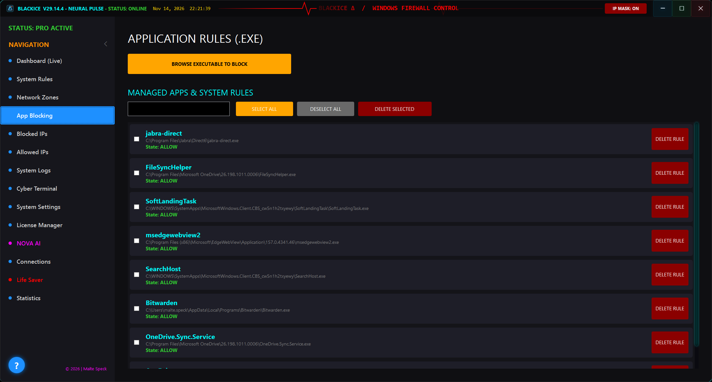
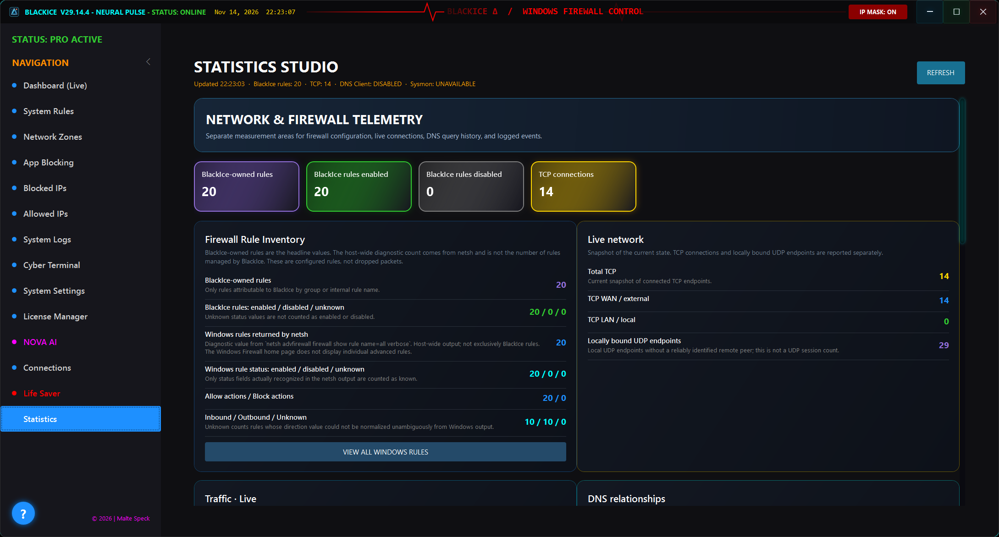

# BlackIce Δ

<strong>Windows-Firewall-Steuerung &amp; Netzwerktransparenz</strong>

Eine zentrale Windows-Desktopoberfläche für Firewallregeln, Netzwerkkontext und Verbindungsdiagnostik.

<a href="README.md">English README</a> · <a href="docs/PRODUCT_OVERVIEW.md">Produktübersicht</a> · <a href="docs/ENGINEERING_OVERVIEW.md">Technische Entwicklung</a> · <a href="docs/SCREENSHOTS.md">Screenshots</a> · <a href="RELEASE_NOTES.md">Trial-Release-Informationen</a>

---

## Was BlackIce ist

**BlackIce Δ ist eine Windows-Desktopanwendung mit einer grafischen Steuerungsoberfläche für die integrierte Windows Defender Firewall und den Netzwerkzustand des lokalen PCs.** Sie bündelt Firewallregel-Verwaltung, Netzwerkzonen, Programmsteuerung, IP-Listen, einen manuellen Internet-Kill-Switch und Verbindungsdiagnostik in einer Oberfläche.

BlackIce ersetzt **nicht** die Windows-Firewall-Engine. Die Paketfilterung übernimmt weiterhin die Windows Defender Firewall. BlackIce liest, erstellt, überprüft und entfernt unterstützte Regeln über Windows-Verwaltungsschnittstellen.

## BlackIce in Screenshots

<table>
<tr><td width="50%">
<strong>Live-Dashboard</strong>
</td><td width="50%">
<strong>Netzwerkzonen</strong>
</td></tr>
<tr><td width="50%">
<strong>Anwendungsregeln</strong>
</td><td width="50%">
<strong>Statistik-Studio</strong>
</td></tr>
</table>

[Zur vollständigen Screenshot-Galerie](docs/SCREENSHOTS.md).

## Zentrale Funktionen

| Bereich | Funktion |
|---|---|
| **System Rules** | Zeigt und verwaltet unterstützte lokale Windows-Firewallregeln einschließlich Status und Richtung. |
| **Network Zones** | Zeigt aktives Windows-Netzwerkprofil, verbundene Netzwerke und Richtlinienstatus. |
| **App Blocking** | Erstellt Ein- und Ausgangsregeln für unterstützte klassische Win32-Programmdateien. |
| **Blocked / Allowed IPs** | Verwaltet getrennte Sperr- und Freigabelisten sowie die zugehörigen Firewallregeln. |
| **Internet Kill Switch** | Manueller IPv4-/IPv6-Internetblock. Lokale und Intranetbereiche sind in den Regelbereichen ausgenommen; beim ersten Start ist die Funktion ausgeschaltet. |
| **Connections & LAN** | Zeigt aktive TCP-Verbindungen und lokale Nachbarinformationen aus den Windows-Netzwerktabellen. |
| **DNS-Diagnostik** | Kombiniert Systemauflösung, DNS-Cache und verfügbare Windows-DNS-Telemetrie. |
| **System Logs & Cyber Terminal** | Bietet Ereignisverlauf der Anwendung und integrierte Netzwerkdiagnostik. |
| **Statistics** | Fasst die dem Client verfügbaren Verbindungs- und Firewallinformationen zusammen. |
| **IP Mask** | Maskiert IP-Text innerhalb von Teilen der BlackIce-Oberfläche. Dies ist keine Anonymisierung des Netzwerkverkehrs. |
| **NOVA AI (optional)** | Optionale, vom Betreiber konfigurierte KI-Anbindung; kein API-Schlüssel ist im Repository enthalten. |

## Funktionsübersicht

## Wie BlackIce technisch aufgebaut wurde

BlackIce ist mit **C# auf .NET 8 für Windows** und einer Windows Presentation Foundation (WPF)-Desktopoberfläche umgesetzt. Die englischen und deutschen Clients sind lokalisierte Varianten derselben funktionalen Produktbasis.

Die Anwendung hat drei zentrale Verantwortungsbereiche: die WPF-Desktopoberfläche, die Windows-Anbindung über NetSecurity-PowerShell-Cmdlets und netsh advfirewall sowie lokalen Netzwerkkontext aus .NET-Netzwerk-APIs, Windows-DNS-/Ereignisquellen, Prozessinformationen und Nachbartabellen.

Die Entwicklung erfolgte schrittweise und Windows-spezifisch: Firewalloperationen wurden zentralisiert, Verbindungs- und DNS-Ansichten an Windows-Telemetrie angebunden und die Funktionsparität zwischen EN und DE gepflegt. Weitere Hintergründe stehen in der [technischen Übersicht](docs/ENGINEERING_OVERVIEW.md).

## Testversionen — Deutsch und Englisch

Die englische (EN) und die deutsche (DE) Client-Version werden mit diesem Release als **Testversionen (Trial)** angeboten. Für beide Sprachversionen gelten dieselben Testoptionen:

- **7-Tage-Free-Trial**
- **30-Tage-Free-Trial**

Die kostenpflichtigen Laufzeiten (25 €, 45 € und 100 €) sind **NOCH NICHT FREIGEGEBEN** und derzeit nicht erhältlich.

## Geplante Lizenzpreise

Die folgenden Werte sind **ausschließlich geplante Anzeigepreise**. Die kostenpflichtigen Laufzeiten sind **NOCH NICHT FREIGEGEBEN** und derzeit kein öffentlich verfügbares Angebot.

| Geplante Laufzeit | Geplanter Preis | Freigabestatus |
|---|---:|---|
| 1 Jahr (365 Tage) | 25 € | **NOCH NICHT FREIGEGEBEN** |
| 2 Jahre (730 Tage) | 45 € | **NOCH NICHT FREIGEGEBEN** |
| Lifetime | 100 € | **NOCH NICHT FREIGEGEBEN** |

Die Preisstufen 25 €, 45 € und 100 € sind keine genehmigten Angebote, können derzeit nicht erworben werden und stellen keine Zusage für eine spätere Verfügbarkeit dar. Sie bleiben einer ausdrücklichen Freigabe vorbehalten und können sich ändern.

## Produktgrenzen und bekannte Einschränkungen

- BlackIce ist eine **Verwaltungsschicht für die Windows Defender Firewall**, kein eigener Firewalltreiber, Antivirus, Endpoint-Detection-System oder VPN.
- App Blocking unterstützt derzeit klassische Win32-Programmdateipfade. Regeln auf Basis von Microsoft-Store-/MSIX-Paketidentitäten sind nicht implementiert.
- Domain Blocking löst aktuelle A-/AAAA-Einträge auf und erstellt IP-basierte Regeln für diese Adressen. Es handelt sich nicht um eine dauerhaft dynamisch aktualisierte FQDN-Regel.
- Die Anzeige blockierter Kill-Switch-Verbindungen nutzt Windows-Filtering-Platform-Sicherheitsereignis 5157. Die Ereignissichtbarkeit setzt die Windows-Fehlerüberwachung voraus.
- Die Prozesszuordnung bei DNS hängt von verfügbaren Telemetriequellen ab. Das Windows-DNS-Client-Ereignis 3008 ist hostweit; das optionale Sysmon-Ereignis 22 kann bei entsprechender Konfiguration prozessbezogene DNS-Informationen ergänzen.
- IP Mask beeinflusst ausschließlich die Darstellung in der Anwendung. Netzwerkpakete, Protokolle oder exportierte Dateien werden dadurch nicht anonymisiert.

## Aktueller Produktstand

| Komponente | Version |
|---|---|
| BlackIce English Client | 29.14.4 |
| BlackIce German Client | 29.14.4 |
| Client-Oberflächenbasis | UI Fix 27 (UI-Fix-21-Basis) |

## Inhalt dieses Repositorys

Dieses Repository ist eine **öffentliche Produkt- und Dokumentationsseite**. Es enthält Produktinformationen, Screenshots und Grafiken, aber keinen Anwendungsquellcode, keine Build-Skripte und keine internen Verwaltungswerkzeuge. Die englische und die deutsche Trial-EXE werden separat als Anhänge des offiziellen GitHub-Trial-Releases bereitgestellt.

## Sicherheit und Datenschutz

Veröffentliche keine Kundenprotokolle, Hardware-IDs, Lizenz-Token, API-Zugangsdaten, privaten Netzwerkdetails oder andere personenbezogene Daten in öffentlichen Issues. Hinweise stehen in [SECURITY.md](SECURITY.md).

## Lizenz

Für die Materialien dieses Repositorys gilt der proprietäre Rechtevorbehalt in [LICENSE](LICENSE). Das Anzeigen oder Herunterladen dieses Repositorys erteilt keine Erlaubnis zur Nutzung, Änderung oder Weitergabe.
