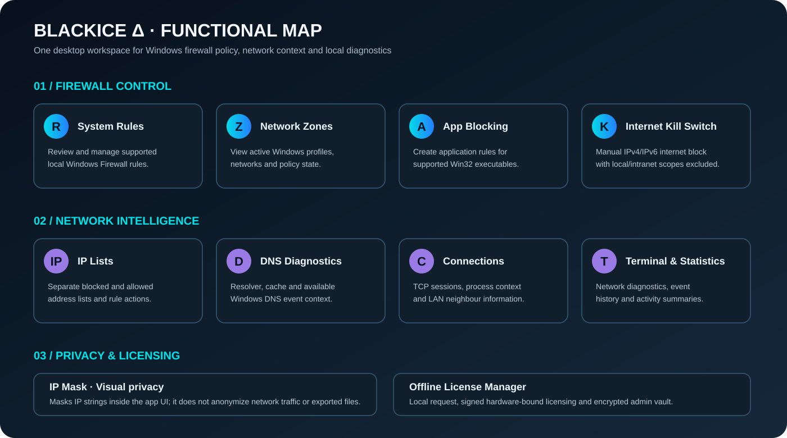
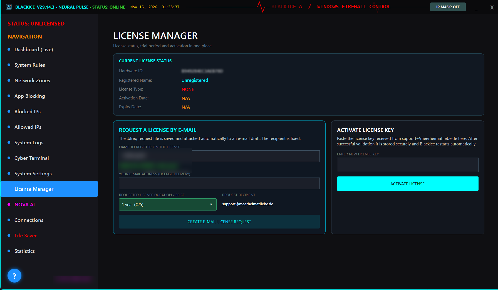
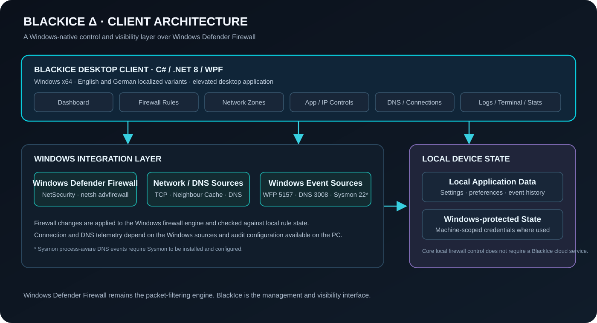
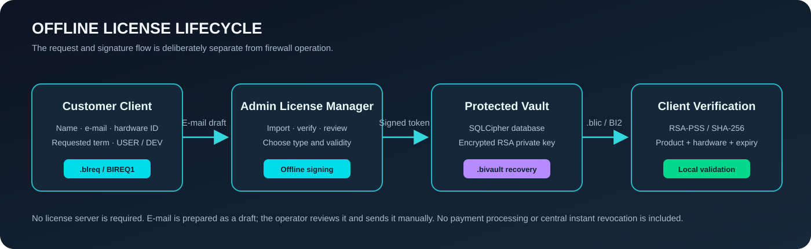

  
  <h1>BlackIce Δ</h1>
  
<strong>Windows-Firewall-Steuerung &amp; Netzwerktransparenz</strong>

  
Eine zentrale Desktop-Oberfläche für Firewallregeln, Netzwerkkontext, Verbindungsdiagnostik und Offline-Lizenzierung.

  

    
    
    
    
    
  

  
<a href="README.md">English README</a> · <a href="docs/PRODUCT_OVERVIEW.md">Produktübersicht</a> · <a href="docs/ENGINEERING_OVERVIEW.md">Technische Entwicklung</a> · <a href="SECURITY.md">Sicherheit</a>

---

## Was BlackIce ist

**BlackIce Δ ist eine Windows-Desktopanwendung, die eine zentrale grafische Steuerungsoberfläche für die integrierte Windows Defender Firewall und den Netzwerkzustand des lokalen PCs bereitstellt.** Sie bündelt Firewallregel-Verwaltung, Netzwerkzonen, Programmsteuerung, IP-Listen, einen manuellen Internet-Kill-Switch und Verbindungsdiagnostik in einer Oberfläche.

BlackIce ersetzt **nicht** die Windows-Firewall-Engine. Die Paketfilterung übernimmt weiterhin die Windows Defender Firewall. BlackIce liest, erstellt, überprüft und entfernt unterstützte Regeln über Windows-Verwaltungsschnittstellen. Dadurch bleibt die Durchsetzung im Betriebssystem; ein eigener Paketfiltertreiber wird nicht eingeführt.

## Das Produkt auf einen Blick

  
   BlackIce-Kundenoberfläche · Ansicht der Lizenzverwaltung. Der persönliche Bedienername wurde im Beispielbild unkenntlich gemacht.

  

## Zentrale Funktionen

| Bereich | Funktion |
|---|---|
| **System Rules** | Zeigt und verwaltet unterstützte lokale Windows-Firewallregeln einschließlich Status und Richtung. |
| **Network Zones** | Zeigt aktives Windows-Netzwerkprofil, verbundene Netzwerke und Richtlinienstatus. |
| **App Blocking** | Erstellt Ein- und Ausgangsregeln für unterstützte klassische Win32-Programmdateien. |
| **Blocked / Allowed IPs** | Verwaltet getrennte Sperr- und Freigabelisten sowie die zugehörigen Firewallregeln. |
| **Internet Kill Switch** | Manueller IPv4-/IPv6-Internetblock. Lokale und Intranetbereiche sind in den Regelbereichen ausgenommen; beim ersten Start ist die Funktion ausgeschaltet. |
| **Connections & LAN** | Zeigt aktive TCP-Verbindungen und lokale Nachbarinformationen aus den Windows-Netzwerktabellen. |
| **DNS-Diagnostik** | Kombiniert Systemauflösung, DNS-Cache und verfügbare Windows-DNS-Telemetrie. |
| **System Logs & Cyber Terminal** | Bietet Ereignisverlauf der Anwendung und integrierte Netzwerkdiagnostik. |
| **Statistics** | Fasst die dem Client verfügbaren Verbindungs- und Firewallinformationen zusammen. |
| **IP Mask** | Maskiert IP-Text innerhalb von Teilen der BlackIce-Oberfläche. Dies ist keine Anonymisierung des Netzwerkverkehrs. |
| **NOVA AI (optional)** | Optionale, vom Betreiber konfigurierte KI-Anbindung; kein API-Schlüssel ist im Repository enthalten. |
| **License Manager** | Unterstützt Kundenanfragen, lokale Aktivierung und einen separaten Offline-Signaturprozess für Administratoren. |

## Wie BlackIce technisch aufgebaut wurde

BlackIce ist mit **C# auf .NET 8 für Windows** und einer WPF-Desktopoberfläche umgesetzt. Die englische und die deutsche Programmversion werden als getrennte lokalisierte Varianten derselben funktionalen Produktbasis gepflegt.

  

Die Anwendung gliedert sich in vier Verantwortungsbereiche:

1. **Desktopoberfläche** – WPF-Fenster und -Steuerelemente bündeln Status, Regeln, Netzwerkkontext und Diagnosefunktionen.
2. **Windows-Anbindung** – PowerShell-Cmdlets aus `NetSecurity` und `netsh advfirewall` verwalten Windows-Firewallregeln. BlackIce prüft die Operationsergebnisse und verifiziert ausgewählte Änderungen anhand des lokalen Windows-Regelspeichers.
3. **Lokaler Kontext und Speicherung** – .NET-Netzwerk-APIs, Windows-DNS-/Ereignisquellen, Prozessinformationen und Nachbartabellen ergänzen die Oberfläche. Lokale Anwendungsdaten verwenden SQLite-/SQLCipher-Komponenten sowie – wo vorgesehen – durch Windows geschützte Maschinendaten.
4. **Lizenzgrenze** – Kundenanfrage und Lizenzprüfung sind vom Offline-Admin-Lizenzmanager getrennt. Dieser verwaltet den privaten Signaturschlüssel und die Ausstellung.

Die Entwicklung erfolgte schrittweise und Windows-spezifisch: Firewalloperationen wurden hinter einer zentralen Verwaltungsschicht gebündelt; Verbindungs- und DNS-Ansichten wurden mit vorhandenen Windows-Telemetriequellen verbunden; EN- und DE-Clients wurden funktional synchron gehalten; und für sensible Quelltext- und Releaseänderungen kamen Preflight- und Guardrail-Prüfungen hinzu. Die technischen Entscheidungen und Entwicklungsschritte sind in der [technischen Übersicht](docs/ENGINEERING_OVERVIEW.md) beschrieben.

## Offline-Lizenzmodell

Für die lokale Aktivierung benötigt BlackIce keinen Lizenzserver. Der Kundenclient erstellt eine `.blreq`-Anfrage. Der separate Admin License Manager importiert sie, lässt den Administrator Kunde und gewünschte Laufzeit prüfen und signiert einen Lizenz-Token. Der Client prüft den Token lokal mit dem eingebetteten öffentlichen Schlüssel und der Hardware-ID des Rechners.

  

| Angefragte Laufzeit | Anzeige / Preis |
|---|---:|
| 7 Tage | Free Trial |
| 30 Tage | Free Trial |
| 1 Jahr (365 Tage) | 25 € |
| 2 Jahre (730 Tage) | 45 € |
| Lifetime | 100 € |

Die Preise sind ausschließlich Metadaten der Anfrage. Das Produkt verarbeitet keine Zahlungen, erstellt keine Rechnungen und prüft keinen Zahlungseingang. Die E-Mail wird als Entwurf geöffnet und muss vom Benutzer geprüft und versendet werden. Die angefragte Laufzeit ist unabhängig vom Ablaufdatum einer bereits installierten Lizenz.

Der Admin License Manager nutzt einen verschlüsselten lokalen Tresor, eine SQLCipher-Datenbank, einen geschützten Datenbankschlüssel und eine verschlüsselte Hülle für den privaten RSA-Schlüssel. V2-Lizenz-Token verwenden RSA-PSS mit SHA-256. Die Wiederherstellung erfolgt über ein separates verschlüsseltes `.bivault`-Paket. Diese Kontrollen sind im [technischen und sicherheitsbezogenen Überblick](docs/ENGINEERING_OVERVIEW.md) beschrieben; eine unabhängige Sicherheitsprüfung ist nicht erfolgt.

## Produktgrenzen und bekannte Einschränkungen

- BlackIce ist eine **Verwaltungsschicht für die Windows Defender Firewall**, kein eigener Firewalltreiber, Antivirus, Endpoint-Detection-System oder VPN.
- App Blocking unterstützt derzeit klassische Win32-Programmdateipfade. Regeln auf Basis von Microsoft-Store-/MSIX-Paketidentitäten sind nicht implementiert.
- Domain Blocking löst die aktuellen A-/AAAA-Einträge auf und erstellt IP-basierte Regeln für diese Adressen. Es handelt sich nicht um eine dauerhaft dynamisch aktualisierte FQDN-Regel; bei einer DNS-Änderung kann eine Aktualisierung nötig sein.
- Die Anzeige blockierter Kill-Switch-Verbindungen nutzt Windows-Filtering-Platform-Sicherheitsereignis `5157`. Die Ereignissichtbarkeit setzt die Windows-Fehlerüberwachung voraus; BlackIce ändert diese Audit-Richtlinie nicht stillschweigend. Einzelne Ereignisse können auch durch andere aktive Firewallregeln ausgelöst worden sein.
- Die Prozesszuordnung bei DNS hängt von verfügbaren Telemetriequellen ab. Das Windows-DNS-Client-Ereignis `3008` ist hostweit; das optionale Sysmon-Ereignis `22` kann bei installierter und konfigurierter Sysmon-Komponente prozessbezogene DNS-Informationen ergänzen.
- IP Mask beeinflusst ausschließlich die Darstellung in der Anwendung. Netzwerkpakete, Protokolle, Screenshots oder exportierte Dateien werden dadurch nicht anonymisiert.
- Offline-Lizenzen verfügen über keinen zentralen Sofortwiderruf und keine Online-Verwaltung von Aktivierungsplätzen.

## Aktueller Quellstand

| Komponente | Version / Basis |
|---|---|
| BlackIce English Client | `29.14.4` |
| BlackIce German Client | `29.14.4` |
| Offline Admin License Manager | `1.0.5` |
| Vollständiger Release-Builder | `1.0.7` |
| Client-Oberflächenintegration | `UI Fix 27` (UI-Fix-21-Basis erhalten) |

Dieses Repository basiert auf UI Fix 27. Das spätere UI-Fix-28-Experiment, das die Auswahl für eine neue Lizenzanfrage an eine bereits installierte Lifetime-Lizenz gekoppelt hat, ist nicht enthalten.

**Prüfgrenze:** Das Repository-Archiv und die Dokumentationsstruktur wurden beim Zusammenstellen geprüft. Ein nativer Windows-Build, die Installer-Ausführung, Firewall-Regeltests sowie ein vollständiger Anfrage-/Import-/Signatur-/Aktivierungstest müssen vor der Freigabe einer Kundenversion noch auf einem Windows-Testsystem erfolgen.

## Repository-Sichtbarkeit und Sicherheitsstatus

> **Dieses Repository muss im aktuellen Quellstand privat bleiben.** Die Clients enthalten noch Legacy-Lizenz- und Kryptografie-Kompatibilitätsmaterial, darunter den alten V1-Prüfpfad und fest eingebettete Legacy-Krypto-/Datenbankkonstanten. Diese Bereiche müssen kontrolliert migriert und sicherheitstechnisch geprüft werden, bevor Quellcode oder Binärdateien öffentlich freigegeben werden. Details stehen in [PUBLIC_RELEASE_BLOCKER.md](PUBLIC_RELEASE_BLOCKER.md).

Niemals Kundenanfragen, signierte Token, Tresorordner, DPAPI-Schlüssel, Lizenzdatenbanken, Recovery-Pakete, NOVA-API-Zugangsdaten oder private Signaturschlüssel committen. Für Sicherheitsmeldungen gilt die [SECURITY.md](SECURITY.md).

## Dokumentation

- [Produktübersicht](docs/PRODUCT_OVERVIEW.md)
- [Technische Übersicht und Entwicklungsgeschichte](docs/ENGINEERING_OVERVIEW.md)
- [Lizenzablauf](docs/LICENSE_WORKFLOW.md)
- [Sicherheitsmodell und aktuelle Release-Einschränkungen](PUBLIC_RELEASE_BLOCKER.md)
- [Änderungshistorie](CHANGELOG.md)
- [Mitwirken](CONTRIBUTING.md)

## Lizenz

Dieser Quellcode steht unter einem **proprietären Rechtevorbehalt** und nicht unter einer Open-Source-Lizenz. Die Datei [`LICENSE`](LICENSE) nennt Malte Speck als Rechteinhaber. Vor einer rechtlichen oder kommerziellen Verteilung muss sichergestellt werden, dass diese Angabe dem tatsächlichen Rechteinhaber entspricht. Ein GitHub-Repository oder Download erteilt keine Erlaubnis, den Quellcode zu verwenden, zu verändern oder weiterzuverteilen.
