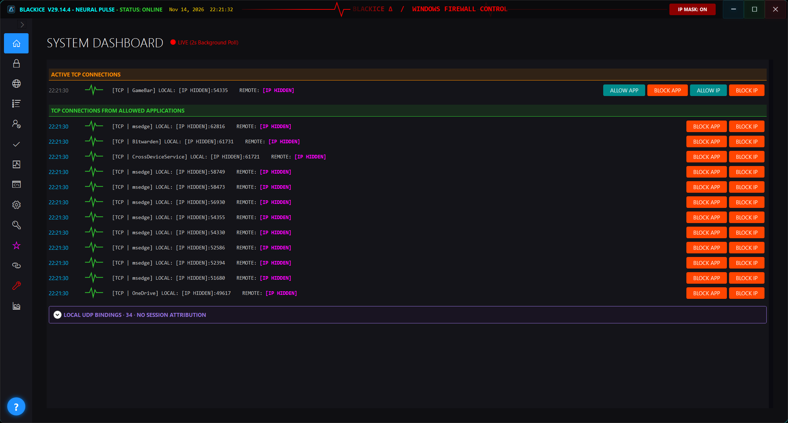
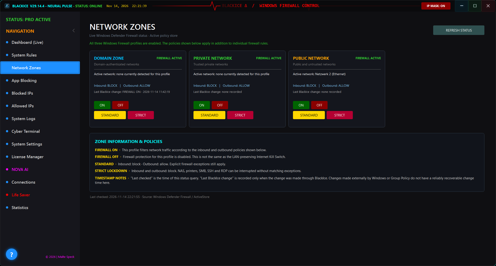
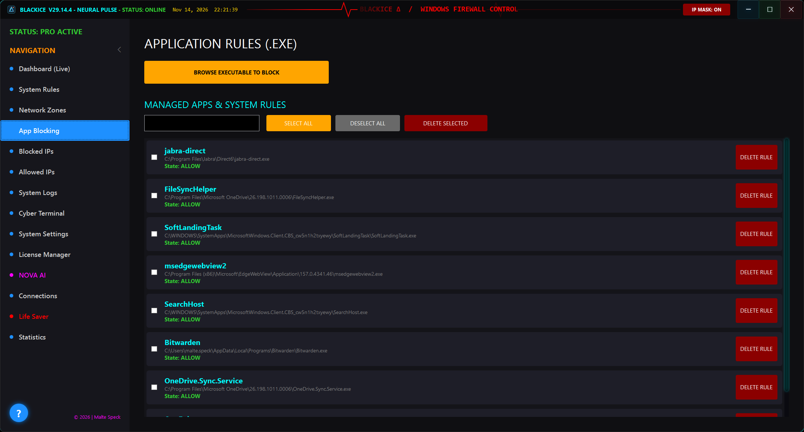
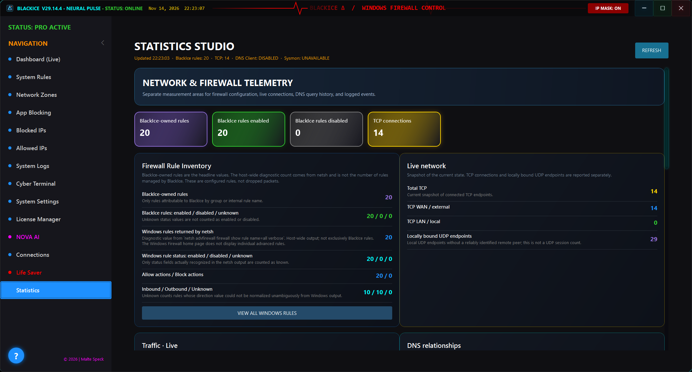
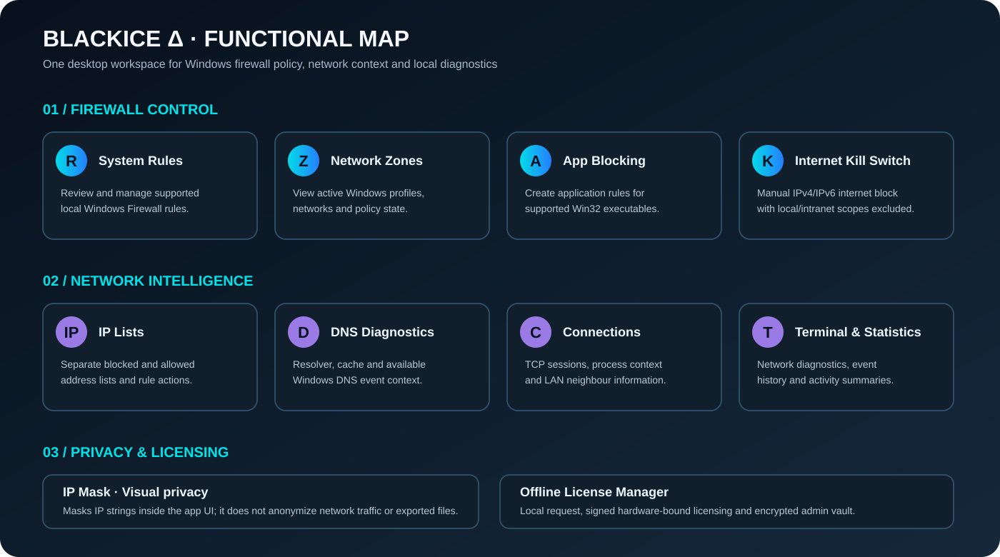
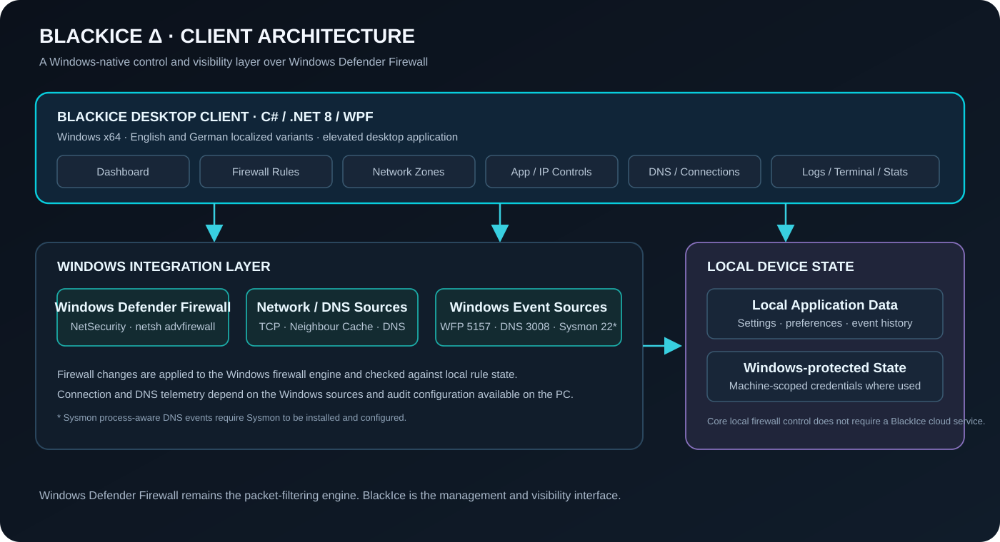

# BlackIce Δ

<strong>Windows Firewall Control &amp; Network Visibility</strong>

A focused Windows desktop workspace for firewall rules, network context and connection diagnostics.

<a href="README.de.md">Deutsche README</a> · <a href="docs/PRODUCT_OVERVIEW.md">Product overview</a> · <a href="docs/ENGINEERING_OVERVIEW.md">Engineering overview</a> · <a href="docs/SCREENSHOTS.md">Screenshots</a> · <a href="RELEASE_NOTES.md">Public preview notes</a>

---

## What BlackIce is

**BlackIce Δ is a Windows desktop application that provides a visual control surface for the built-in Windows Defender Firewall and the network state of the local PC.** It brings firewall-rule management, network-zone context, application controls, IP lists, a manual Internet Kill Switch and connection diagnostics into one interface.

BlackIce does **not** replace the Windows firewall engine. Windows Defender Firewall remains responsible for packet filtering. BlackIce reads, creates, verifies and removes supported rules through Windows management interfaces.

## BlackIce in screenshots

<table>
<tr><td width="50%">
<strong>Live dashboard</strong>
</td><td width="50%">
<strong>Network zones</strong>
</td></tr>
<tr><td width="50%">
<strong>Application rules</strong>
</td><td width="50%">
<strong>Statistics studio</strong>
</td></tr>
</table>

[View the complete screenshot gallery](docs/SCREENSHOTS.md).

## Core capabilities

| Area | What it does |
|---|---|
| **System Rules** | Inspects and manages supported local Windows Firewall rules, including state and direction. |
| **Network Zones** | Shows the active Windows network profile, connected networks and firewall policy state. |
| **App Blocking** | Creates inbound and outbound rules for supported classic Win32 executable paths. |
| **Blocked / Allowed IPs** | Maintains explicit address lists and corresponding Windows Firewall rules. |
| **Internet Kill Switch** | Provides a manual IPv4/IPv6 Internet block. Its rule scopes are designed to leave local and intranet ranges reachable; it is off by default. |
| **Connections & LAN context** | Presents active TCP sessions and local-neighbour context from Windows network tables. |
| **DNS diagnostics** | Combines system resolver results, DNS cache information and available Windows DNS telemetry. |
| **System Logs & Cyber Terminal** | Provides application event history and built-in network diagnostics. |
| **Statistics** | Summarizes the connection and firewall information available to the client. |
| **IP Mask** | Visually masks IP strings in parts of the BlackIce UI. It is a display aid, not traffic anonymization. |
| **NOVA AI (optional)** | Provides an optional AI integration configured by the operator; no API credential is bundled. |

## Functional map

## How it is engineered

BlackIce is implemented in **C# on .NET 8 for Windows**, with a Windows Presentation Foundation (WPF) desktop interface. English and German clients are maintained as localized variants of the same functional product baseline.

The application has three main responsibilities: the WPF desktop experience; Windows integration through NetSecurity PowerShell cmdlets and netsh advfirewall; and local network context from .NET networking APIs, Windows DNS/event sources, process information and neighbour tables.

The development approach was incremental and Windows-specific: firewall operations were consolidated behind a central management layer, connection and DNS views were connected to Windows telemetry, and English/German client parity was maintained. See the [engineering overview](docs/ENGINEERING_OVERVIEW.md).

## Planned license pricing

The following values are **planned display prices only**. The paid plans are **NOT YET RELEASED** and are not currently available as a public offer.

| Planned term | Planned price | Release status |
|---|---:|---|
| 7 days | Free Trial | Trial option |
| 30 days | Free Trial | Trial option |
| 1 year (365 days) | €25 | **NOT YET RELEASED** |
| 2 years (730 days) | €45 | **NOT YET RELEASED** |
| Lifetime | €100 | **NOT YET RELEASED** |

The €25, €45 and €100 price points are not approved offers, cannot currently be purchased and do not promise availability. They remain subject to formal release approval and may change.

## Product boundaries and known limitations

- BlackIce is a **management layer for Windows Defender Firewall**, not a replacement firewall driver, antivirus, endpoint-detection platform or VPN.
- App Blocking currently targets supported classic Win32 executable paths; Microsoft Store/MSIX package-identity rules are not implemented.
- Domain blocking resolves current A/AAAA records and creates IP-based rules for those addresses. It is not a continuously updated FQDN policy.
- Kill Switch blocked-attempt visualization uses Windows Filtering Platform Security event 5157. Event visibility depends on Windows failure auditing being enabled.
- DNS process attribution depends on available telemetry. Windows DNS Client event 3008 is host-level; optional Sysmon event 22 can add process-aware DNS information when configured.
- IP Mask changes only what is displayed in the application. It does not anonymize packets, logs or exported files.

## Current product baseline

| Component | Version |
|---|---|
| BlackIce English client | 29.14.4 |
| BlackIce German client | 29.14.4 |
| Client UI baseline | UI Fix 27 (UI Fix 21 base) |

## Repository contents

This is a **public-facing product and documentation repository**. It contains product information, screenshots and diagrams. It does not publish application source code, executable releases, internal administration utilities, private credentials or customer data.

## Security and privacy

Do not submit customer logs, hardware identifiers, license tokens, API credentials, private network details or other personal data in public issues. See [SECURITY.md](SECURITY.md).

## License

The materials in this repository are covered by the proprietary notice in [LICENSE](LICENSE). No permission to use, modify or redistribute the materials is granted by viewing or downloading this repository.
