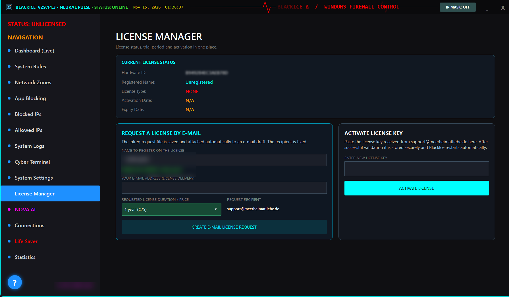
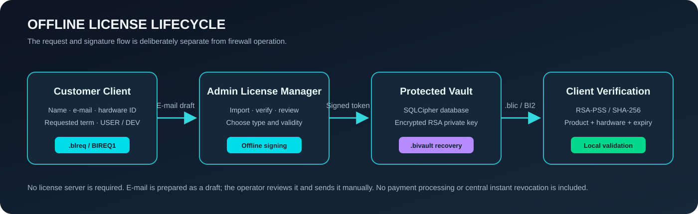

  
  <h1>BlackIce Δ</h1>
  
<strong>Windows Firewall Control &amp; Network Visibility</strong>

  
One focused desktop workspace for firewall rules, network context, connection diagnostics and offline licensing.

  

    
    
    
    
    
  

  
<a href="README.de.md">Deutsche README</a> · <a href="docs/PRODUCT_OVERVIEW.md">Product overview</a> · <a href="docs/ENGINEERING_OVERVIEW.md">How it is engineered</a> · <a href="SECURITY.md">Security</a>

---

## What BlackIce is

**BlackIce Δ is a Windows desktop application that gives an operator a single, visual control surface for the built-in Windows Defender Firewall and the network state of the local PC.** It organizes rule management, network-zone context, application controls, IP lists, a manual Internet Kill Switch and connection diagnostics in one interface.

BlackIce does **not** replace the Windows firewall engine. Windows Defender Firewall remains responsible for packet filtering; BlackIce reads, creates, verifies and removes supported rules through Windows management interfaces. This keeps enforcement in the operating system rather than introducing a separate packet-filter driver.

## The product at a glance

  
   BlackIce customer interface · License Manager view. Personal operator name redacted from the example image.

  

## Core capabilities

| Area | What it does |
|---|---|
| **System Rules** | Inspects and manages supported local Windows Firewall rules, including rule state and direction. |
| **Network Zones** | Shows the active Windows network profile, connected networks and firewall policy state. |
| **App Blocking** | Creates inbound/outbound rules for supported classic Win32 executable paths. |
| **Blocked / Allowed IPs** | Maintains explicit address lists and corresponding Windows Firewall rules. |
| **Internet Kill Switch** | Provides a manual IPv4/IPv6 Internet block. Its rule scopes are designed to leave local and intranet ranges reachable; it is off by default. |
| **Connections & LAN context** | Presents active TCP sessions and local-neighbour context from Windows network tables. |
| **DNS diagnostics** | Combines system resolver results, DNS cache information and available Windows DNS telemetry. |
| **System Logs & Cyber Terminal** | Provides application event history and built-in network diagnostics. |
| **Statistics** | Summarizes the connection and firewall information available to the client. |
| **IP Mask** | Visually masks IP strings in parts of the BlackIce UI. It is a display aid, not traffic anonymization. |
| **NOVA AI (optional)** | Provides an optional AI integration configured by the operator; no API credential is bundled. |
| **License Manager** | Supports customer license requests, local activation and a separate offline admin signing workflow. |

## How it is engineered

BlackIce is implemented in **C# on .NET 8 for Windows**, with a WPF desktop interface. The English and German clients are maintained as separate localized variants of the same functional product baseline.

  

The application is organized around four responsibilities:

1. **Desktop experience** — WPF windows and controls present status, rules, network context and diagnostics in one consistent interface.
2. **Windows integration** — PowerShell `NetSecurity` cmdlets and `netsh advfirewall` manage Windows Firewall rules. BlackIce checks operation results and verifies selected rule changes against the local Windows rule store.
3. **Local context and persistence** — .NET networking APIs, Windows DNS/event sources, process information and neighbour tables enrich the UI. Local application data is stored using SQLite/SQLCipher components and Windows-protected machine data where configured.
4. **Licensing boundary** — customer-side license requests and validation are separated from the offline Admin License Manager, which owns the signing key and issuance workflow.

The development approach was incremental and Windows-specific: firewall operations were added behind a central management layer; connection and DNS views were connected to existing Windows telemetry sources; the EN and DE clients were kept in parity; and preflight/guardrail checks were added around sensitive source and release changes. See [the engineering overview](docs/ENGINEERING_OVERVIEW.md) for the technical decisions and development history.

## Offline licensing model

BlackIce does not require a license server for local activation. The customer client creates a `.blreq` request file; the separate Admin License Manager imports it, lets the operator review the customer and requested term, and signs a license token. The client validates the token locally using the embedded public key and the machine's hardware identifier.

  

| Request term | Displayed price / label |
|---|---:|
| 7 days | Free Trial |
| 30 days | Free Trial |
| 1 year (365 days) | €25 (not published yet)|
| 2 years (730 days) | €45 (not published yet) |
| Lifetime | €100 (not published yet) |

Prices are informational request metadata only. The product does not process payments, generate invoices or verify payment receipt. E-mail is opened as a draft for the customer to review and send. The requested term is separate from the expiry of a license already installed on the PC.

The Admin License Manager uses an encrypted local vault, SQLCipher database storage, a protected database key and an encrypted RSA private-key envelope. V2 license tokens use RSA-PSS with SHA-256. Recovery is handled through a separate encrypted `.bivault` package. These controls are described in the [License Manager security model](LicenseManager/SECURITY_MODEL.md); they have not been independently audited.

## Product boundaries and known limitations

- BlackIce is a **management layer for Windows Defender Firewall**, not a replacement firewall driver, antivirus, endpoint detection platform or VPN.
- App Blocking currently targets supported classic Win32 executable paths; Microsoft Store/MSIX package-identity rules are not implemented.
- Domain blocking resolves the current A/AAAA records and creates IP-based rules for those addresses. It is not a continuously updated FQDN policy; a DNS change can require the rule to be refreshed.
- Kill Switch blocked-attempt visualization uses Windows Filtering Platform Security event `5157`. Event visibility depends on Windows failure auditing being enabled; BlackIce does not silently change that audit policy. An individual event may have been caused by another active firewall rule.
- DNS process attribution depends on available telemetry. Windows DNS Client event `3008` is host-level; optional Sysmon event `22` can add process-aware DNS information when Sysmon is installed and configured.
- The IP Mask changes only what is displayed in the application. It does not anonymize packets, logs, screenshots or exported files.
- Offline licenses do not have central instant revocation or online activation-seat management.

## Current source baseline

| Component | Version / baseline |
|---|---|
| BlackIce English client | `29.14.4` |
| BlackIce German client | `29.14.4` |

**Validation boundary:** the repository archive and documentation structure were checked during packaging. A native Windows compilation, installer execution, firewall rule test and full request/import/sign/activation test must still be completed on a Windows test machine before a customer release is declared ready.

## Repository visibility and security status

> **Keep this repository private in the current source state.** The client still contains legacy licensing and cryptographic compatibility material, including the legacy V1 verifier and fixed legacy crypto/database constants. These paths need a deliberate migration and security review before any public source or binary release. See [PUBLIC_RELEASE_BLOCKER.md](PUBLIC_RELEASE_BLOCKER.md).

Never commit customer requests, signed tokens, vault folders, DPAPI keys, license databases, recovery packages, NOVA API credentials or private signing keys. Use [SECURITY.md](SECURITY.md) for vulnerability reporting.

## Documentation

- [Product overview](docs/PRODUCT_OVERVIEW.md)
- [Engineering overview and development history](docs/ENGINEERING_OVERVIEW.md)
- [License workflow](docs/LICENSE_WORKFLOW.md)
- [Security model and current release restrictions](PUBLIC_RELEASE_BLOCKER.md)
- [Changelog](CHANGELOG.md)
- [Contributing](CONTRIBUTING.md)

## License

This source is distributed under a **proprietary, all-rights-reserved notice**, not an open-source license. The legal copyright-holder field in [`LICENSE`](LICENSE) must be completed by the rights holder before distribution. A GitHub repository or download does not grant permission to use, modify or redistribute the source.
