# BlackIce Δ — Screenshot Gallery

The following images show the BlackIce Windows client interface. Images are stored under docs/assets/screenshots/ and referenced with relative paths so GitHub renders them directly.

> This gallery contains BlackIce client screens only. Internal administrative utilities and their interfaces are not included.

## Dashboard and firewall

| Dashboard | Dashboard — wide view |
|---|---|
| 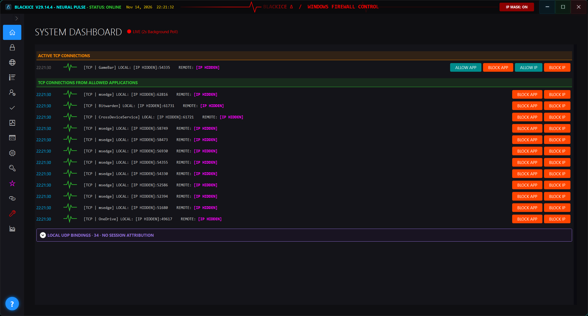 | 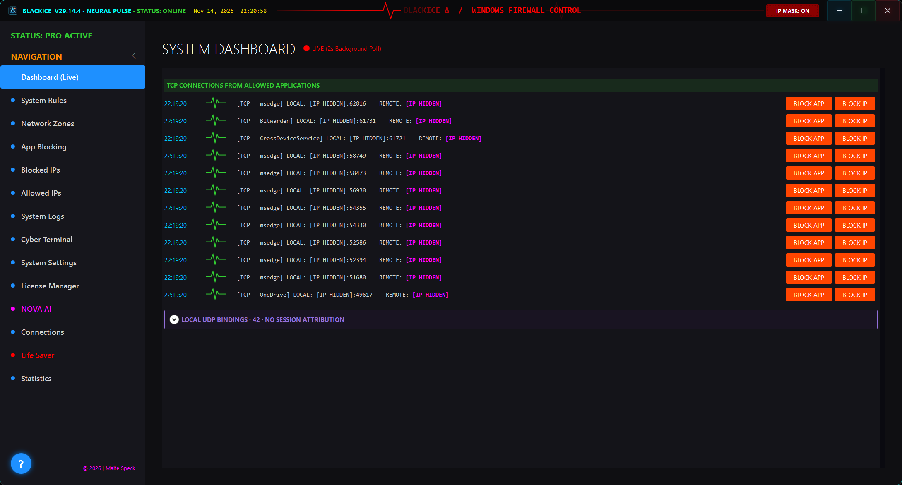 |

| System rules | Network zones |
|---|---|
| 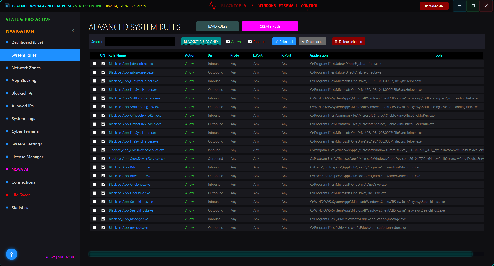 | 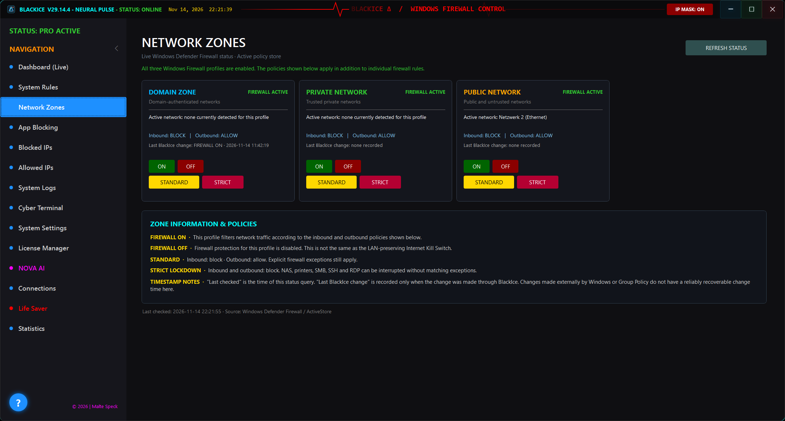 |

| Network zones | Application rules |
|---|---|
|  | 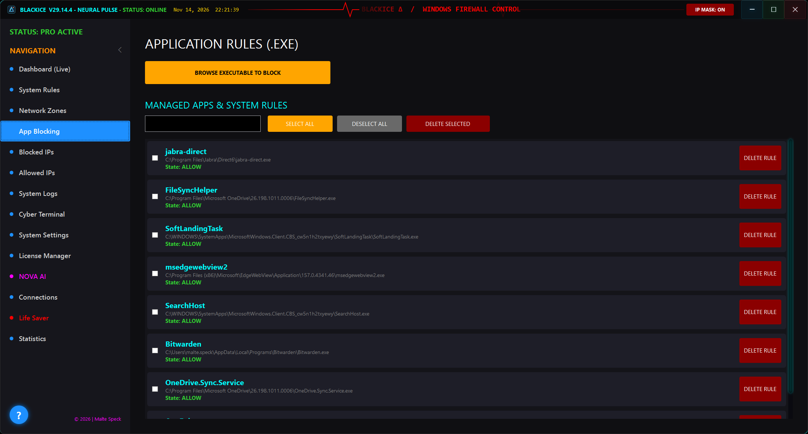 |

| App blocking | Allowed IPs |
|---|---|
| 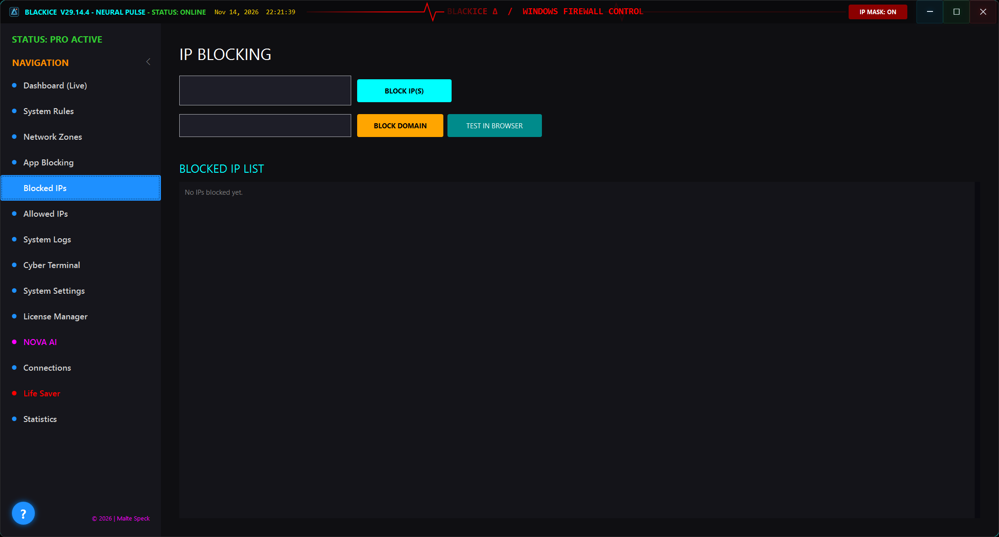 | 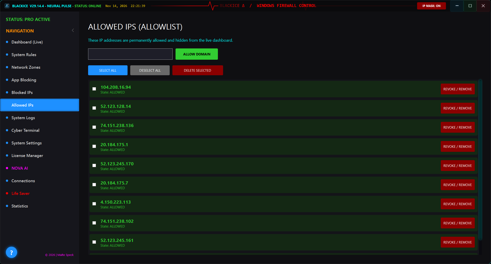 |

## Monitoring and diagnostics

| System logs | Cyber Terminal |
|---|---|
| 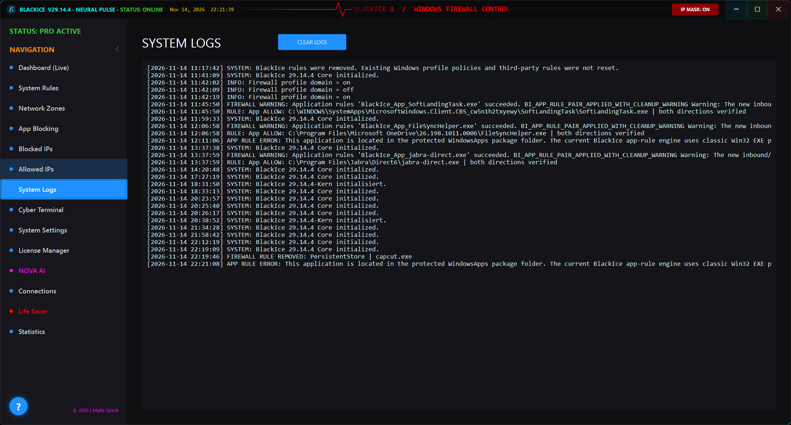 | 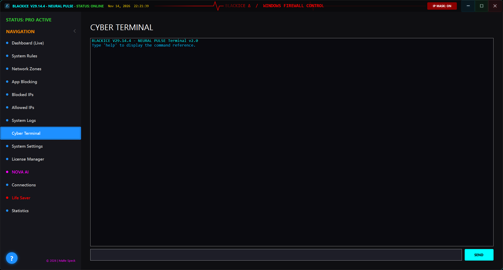 |

| Live connections matrix | LAN connections |
|---|---|
| 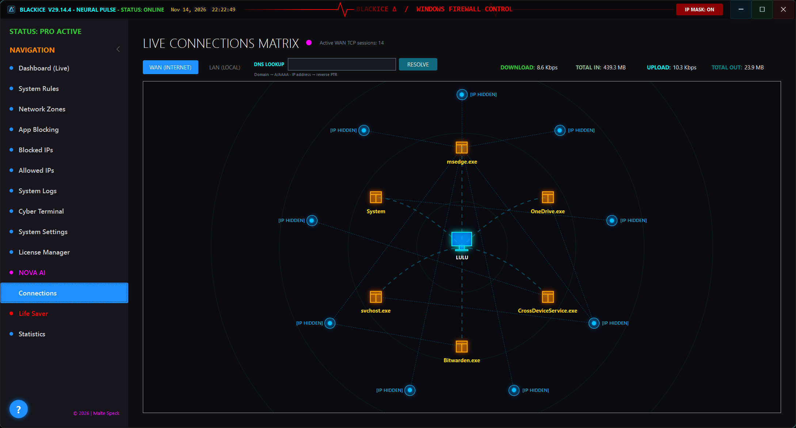 | 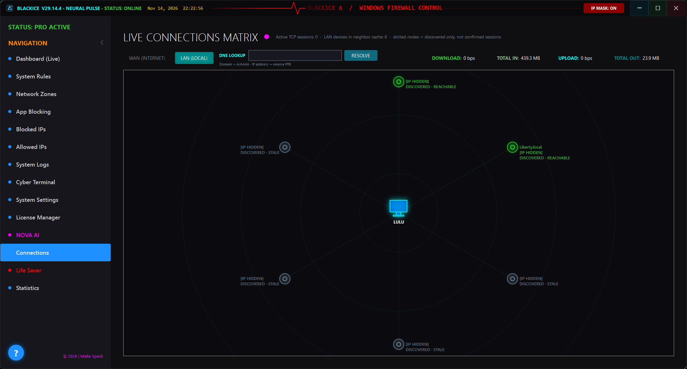 |

## System tools and analytics

| System settings | Life Saver |
|---|---|
| 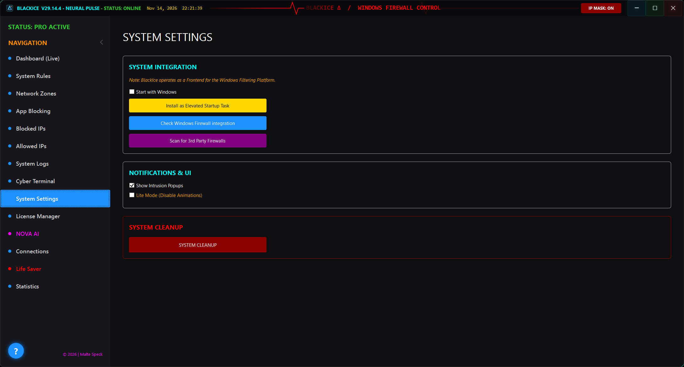 | 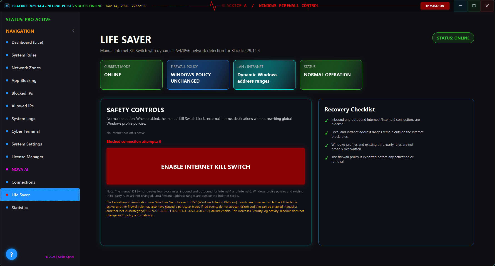 |

| Statistics overview | Statistics details |
|---|---|
| 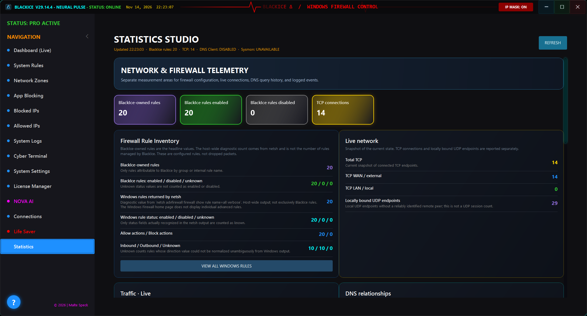 | 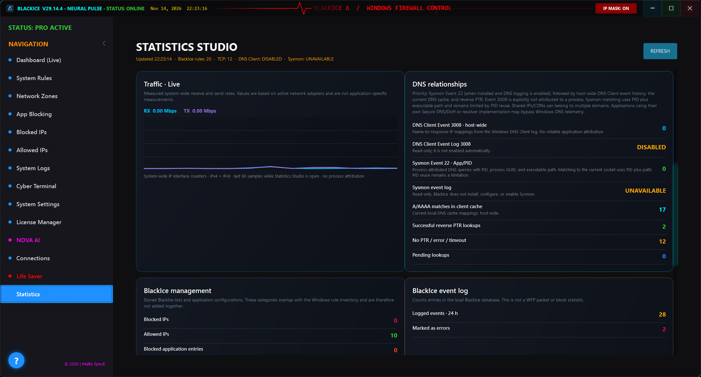 |

| Statistics additional view | User guide |
|---|---|
| 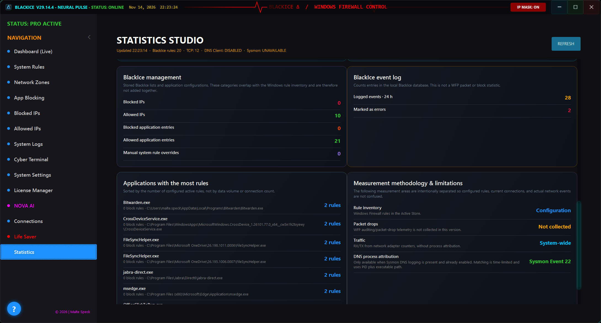 | 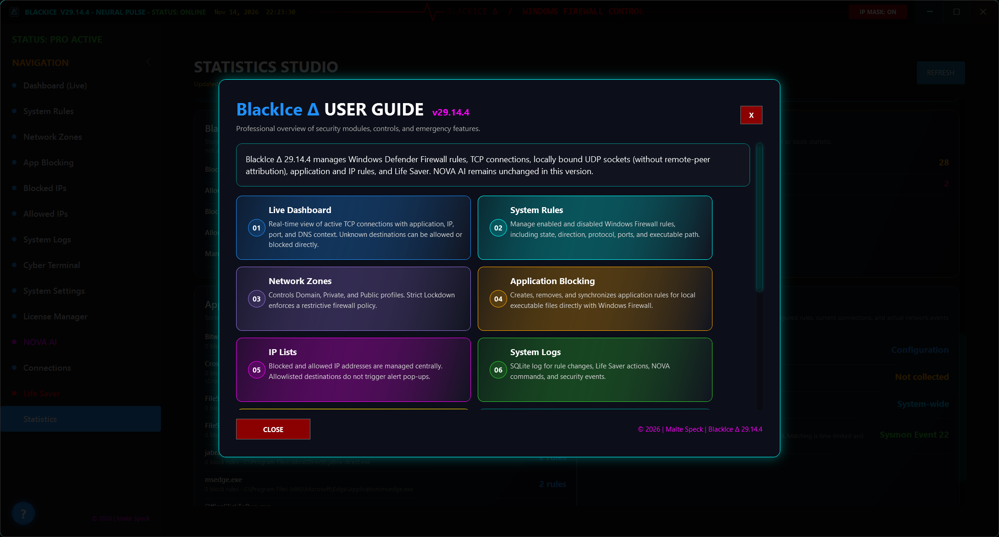 |

The screenshots are illustrative product views, not test evidence for every Windows configuration or network environment.
